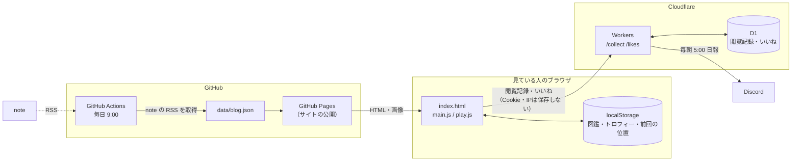

# HARUTA NAGAYA — Game Programmer Portfolio

ゲームプログラマー志望（2028年卒）長屋晴太のポートフォリオサイトです。

**▶ サイト：https://haru2401game.github.io/portfolio/**

「ポートフォリオそのものを、1本のゲームのように遊べるものにする」をテーマに作っています。
作品や経歴を眺めるだけでなく、ステージを進み、キャラクターを見つけ、エンディングまでたどり着けます。
一方で、採用担当の方がすばやく情報を確認できるよう、アニメーションの強さや言語を選べる **設定画面（OPTIONS）** も用意しています。

---

## 目次

1. [主な機能](#主な機能)
2. [使っている技術](#使っている技術)
3. [全体の構成](#全体の構成)
4. [ファイル構成](#ファイル構成)
5. [工夫したポイント](#工夫したポイント)
6. [更新のしかた](#更新のしかた)
7. [確認のしかた](#確認のしかた)

---

## 主な機能

### 内容

| セクション | 内容 |
|---|---|
| 30秒でわかる 長屋晴太 | 目指す職種・得意な技術・代表作・実績を1枚にまとめたカード |
| About | プロフィール |
| Achievements | 作品数・ブログ記事数・受賞数などの実績（数字はページ内から自動で集計） |
| Main Works | 代表作2本（ししとう／Falien）をタブで切り替え。動画は押すと再生（最初は画像なので通信量が少ない）。技術の見どころ（課題→解決→結果）、チーム構成、写真 |
| Other Works | その他の作品。ゲームカセット風のカード、絞り込み、詳細ポップアップ |
| Play Games | 実際に遊べるサイト（unityroom など）へのリンク |
| What I Can Do | 作品データから自動で作るステータス画面と、スキルの説明 |
| Timeline | 経歴。ステージ選択風のワールドマップ付き |
| Blog | note の最新記事（毎日自動で更新） |
| Contact | メール・SNS |
| Ending | クレジット・プレイタイムとランク |

### 遊びの仕掛け（`js/play.js`）

| 仕掛け | 内容 |
|---|---|
| キャラクター図鑑 | サイトのあちこちで顔を出すキャラをクリックすると図鑑に登録。全員見つけるとエンディングに隠しメッセージ |
| トロフィー | 13種類。条件を満たすと解除され、フッターから一覧を見られる |
| 隠しコマンド | ↑↑↓↓←→←→BA（スマホはロゴを5回タップ・コントローラーでも入力できる）でキャラが画面を駆け抜ける |
| ゲームパッド操作 | コントローラーをつなぐと、十字キーでカーソル移動・A で決定・B で戻る・LB / RB でセクション移動・START で設定。使っている間は左下に操作ガイドを表示 |
| ステージ進行バー | ヘッダーの下に、今どのセクションまで進んだかを表示 |
| つづきから | 2回目の訪問で、前回見ていたセクションへ案内 |
| プレイタイムとランク | 見た時間・読んだセクション・開いた作品などから S〜C ランクを表示 |
| 季節イベント | 日付で自動切り替え（お正月・春・ハロウィン・クリスマス・冬） |
| 404ミニゲーム | 存在しないページを開くと、キャラで障害物をよけるランゲームが遊べる |

### 見る人への配慮

- **設定画面（⚙ OPTIONS）**：ゲームの設定画面のように、アニメーションの強さ（デフォルト・軽量・なし）・動画の音量・効果音・言語（日本語 / English）を切り替えられる。端末で「視差効果を減らす」を設定している人は、最初から「なし」
- **効果音（`js/sfx.js`）**：Web Audio で、その場で音を作って鳴らす（音声ファイルは使わない）。カードを選ぶ・タブや絞り込みを切り替える・一覧を開閉する・ポップアップを開閉する・メールのコピー・トロフィー解除・新しいステージに進んだときなど、操作ごとに音を変えている。最初は OFF で、設定画面から ON にできる
- **押した手ごたえ**：切り替えボタンやカードは、押した瞬間に少し沈む（アニメーション「なし」のときは動かない）
- **スマホ表示**：カードの横スワイプ、実績の2列表示、技術解説の折りたたみなどで、縦の長さを約2割短縮
- **キーボード操作**：タブ・ポップアップ・ワールドマップは、キーボードだけでも操作できる。最初の Tab で「本文へスキップ」が出る
- **アクセシビリティ**：WCAG 2.1 AA の主な項目（文字のコントラスト・フォーカスの見え方・ボタンの名前・文字間隔を広げたときの表示など）を自動テストで確認している。トップの動画は ❚❚ ボタンで止められる

---

## 使っている技術

| 分類 | 技術 |
|---|---|
| サイト | HTML / CSS / JavaScript（フレームワークなし） |
| 公開 | GitHub Pages |
| ブログの自動更新 | GitHub Actions（毎日 9:00）＋ Node.js（rss-parser・axios・cheerio） |
| アクセス解析 | Cloudflare Workers ＋ D1（SQLite）※自作・別リポジトリ（非公開） |
| 日報 | Discord Webhook（毎朝 5:00 に前日の閲覧数・読まれたセクション・クリックされた作品を通知） |
| フォント・アイコン | Google Fonts（Inter・Noto Sans JP）、Font Awesome Free の SVG（使う分だけ CSS に埋め込み） |
| 確認 | Playwright（画面幅ごとの表示・動作・見た目を自動で確認） |

**フレームワークを使っていない理由**：ページが1枚で、表示の速さと、仕組みを自分で説明できることを優先したためです。
DOM の操作、スクロールの検知（IntersectionObserver）、ポップアップ（`<dialog>`）、Canvas でのゲーム描画などは、ブラウザ標準の機能だけで作っています。

---

## 全体の構成



### データの流れ

- **作品・経歴の情報は HTML に書く**。数字（作品数・受賞数・開発歴など）、バッジ（RARE・TEAM）、絞り込み、ステータス画面、ワールドマップは、JavaScript がページ内の HTML から自動で作る
- **ブログの記事**は GitHub Actions が毎日 note の RSS から `data/blog.json` を作り直す。ファイルを直接開いたとき（`file://`）用に、同じ内容の `data/blog.js` も作る
- **アクセス解析**は、ページ内のセクションを自動で見つけて記録する。セクションを追加・削除しても、解析側を直す必要はない

---

## ファイル構成

```
portfolio/
├── index.html            ページ本体（内容はすべてここに書く）
├── 404.html              ページが見つからないとき（ミニゲーム）
├── sitemap.xml           検索エンジン向けのページ一覧
├── css/
│   └── style.css         見た目
├── js/
│   ├── main.js           基本の動き（自動集計・ポップアップ・タブ・スマホ表示など）
│   ├── play.js           遊びの仕掛け（図鑑・トロフィー・隠しコマンド・ワールドマップなど）
│   ├── settings-boot.js  設定（動き・言語）を、ページを描く前に反映
│   ├── analytics.js      アクセス解析の送信
│   ├── like.js           いいねボタン
│   ├── sfx.js            効果音
│   ├── gamepad.js        ゲームパッド操作
│   └── i18n.js           日本語 ⇄ 英語の切り替え（辞書は data/i18n-en.js）
├── data/
│   ├── blog.json         note の最新記事（自動更新）
│   ├── blog.js           blog.json の写し（file:// で開いたとき用）
│   └── profile.json      ページから数えられない数字（イベント参加数など）
├── scripts/
│   └── update-note.js    note の記事を取得するスクリプト
├── .github/workflows/
│   └── update-note.yml   毎日の自動更新
├── images/               画像（WebP）・キャラクター
└── videos/               動画（トップの動画は、スマホ用の軽い版 -sm も用意）
```

### JavaScript の役割分担

| ファイル | 役割 |
|---|---|
| `main.js` | 共通の道具（保存・動きの判定・要素の作成など）を先頭にまとめ、各セクションの動きを独立したブロック（即時関数）で書いている |
| `play.js` | `main.js` の共通の道具を使って、遊びの仕掛けを追加する。アニメーションが「軽量」「なし」のときは演出を控える |
| `analytics.js` | クリックや読まれたセクションを、まとめて解析サーバーへ送る |
| `like.js` | いいねボタン。連打はまとめて送り、サーバー側でも回数を制限している |
| `sfx.js` | クリック・キー操作・カスタムイベントを聞いて、操作の種類に合った効果音を鳴らす。ほかのファイルは音のことを知らなくてよい |
| `gamepad.js` | Gamepad API でコントローラーの入力を読み、画面上の位置からとなりのボタンを探してカーソルを動かす。音は `sfx.js`、通知やトロフィーは `play.js` に任せる |
| `i18n.js` | 英語を選んだときだけ辞書を読み込み、あとから出てくる文言も含めて訳す |

ファイルどうしは、カスタムイベントでやり取りしています（例：作品のポップアップを開いたら `work-viewer:open`、隠し要素が見つかったら `play:event`）。
これにより、`main.js` は解析やトロフィーのことを知らなくても動きます。

---

## 工夫したポイント

### 1. 内容を書き足すだけで、全部が自動で更新される

作品カードを1枚追加すると、作品数・絞り込みの件数・ステータス画面の数値・3Dゲームチャレンジの進み具合・エンディングの集計が、すべて自動で変わります。
経歴に受賞を書けば、その作品のカードが自動で金色の **RARE** になります（本文の「」から作品名を見つけています）。

数字を手で書き換える場所をなくすことで、**更新し忘れによる食い違い**が起きないようにしました。

### 2. 「遊び」と「見やすさ」の両立

ゲーム好きの人には遊べるサイトに、忙しい採用担当の方にはすぐ読めるサイトにしたいと考えました。

- 演出は「気づいた人だけが楽しめる」ものに絞り、内容を読む邪魔をしない
- 設定画面で、アニメーションを「軽量」「なし」に下げられる
- 画面外のアニメーションは止め、動きを減らす設定にも対応

### 3. セキュリティ

- **Content-Security-Policy** で、読み込んでよい場所（自分のファイル・Google Fonts・note の画像・解析サーバー）を限定
- 外部から取り込む文章（ブログの記事タイトルなど）は、`innerHTML` ではなく `textContent` で入れて、スクリプトが混ざっても動かないようにしている
- 外部リンクには `rel="noopener noreferrer"` を付けている
- 解析サーバー側では、ログインの総当たり対策、同じ相手からの連続送信の制限、日報に偽のリンクが混ざらないための文字の除去を行っている

### 4. プライバシーに配慮したアクセス解析

Google Analytics などは使わず、必要な情報だけを集める解析を自作しました。

- Cookie を使わず、訪問の区別はタブを閉じると消えるランダムな ID だけ
- IP アドレスは保存しない
- 自分の閲覧は URL に `?notrack` を付けて一度開けば除外できる

### 5. 404 ミニゲーム（`404.html`）

Canvas で描くランゲームです。

- **重力とジャンプ**：毎フレーム、速度に重力を足し、位置に速度を足す（経過時間 `dt` を掛けて、画面の速さに左右されないようにしている）
- **当たり判定**：キャラと障害物を四角形として、重なっているかを調べる（見た目より少し小さい四角にして、理不尽な当たりを減らしている）
- **難易度**：時間とともに速くなり、スコア150からは「ジャンプしてはいけない」空飛ぶ敵が出る
- 高解像度の画面でもドット絵がにじまないよう、`devicePixelRatio` に合わせて描画している

### 6. 表示の速さ

- アイコンは外部の CSS・フォントを読み込まず、使っている分の SVG だけを CSS に埋め込んでいる（外部への接続が1つ減り、約300KB 軽い）
- 画像は表示サイズに合わせて縮小・圧縮（WebP）。最初に見える画像は先に読み込む
- トップの動画は、スマホでは軽い版（480p）を使う。データセーバーの設定をしている人には動画を流さない
- Main Works の動画は押したときだけ読み込む

### 7. 品質の確認

公開する前に、Playwright（ブラウザを自動で操作するツール）で次のことを確認しています。
（確認用のスクリプトは、このリポジトリには含めていません）

- 320px〜1440px の各画面幅で、横のはみ出し・小さすぎる文字・文字の読みにくさがないか
- 図鑑・トロフィー・ポップアップ・タブ・設定画面・効果音などが動くか
- コードを整理したときに、全要素の見た目（計算後のスタイル）が変わっていないか

---

## 更新のしかた

| やりたいこと | 書く場所 |
|---|---|
| 作品を追加する | `index.html` の Other Works に `.work-card` を1つ追加（いちばん上が最新） |
| 経歴を追加する | `index.html` の Timeline に `.timeline-item` を追加。受賞は `data-quest="award"`、挑戦中は `data-quest="now"` |
| 受賞作にする | 受賞の経歴の本文に「作品名」と書く（カードのタイトルと同じ名前） |
| イベント参加数を変える | `data/profile.json` の `eventCount` |
| 外部の画像やスクリプトを使う | `index.html` 先頭の Content-Security-Policy に、読み込み元を追加 |
| アイコンを増やす | `css/style.css` の「アイコン」の欄に、Font Awesome の SVG から1行追加（使い方は `<i class="fa-solid fa-○○">` のまま） |
| 季節イベントを確認する | URL の末尾に `?season=halloween` など（`newyear` `spring` `halloween` `christmas` `winter`） |

ブログの記事は自動で更新されるので、手で直す必要はありません。

---

## 確認のしかた

ローカルで確認するときは、フォルダで簡易サーバーを起動して開きます（`file://` で直接開くと、一部の読み込みが動きません）。

```bash
python -m http.server 8000
# → http://localhost:8000/ を開く
```

自分の閲覧をアクセス解析に入れたくないときは、公開サイトを一度だけ `?notrack` 付きで開いてください。

---

© 2026 HARUTA NAGAYA
